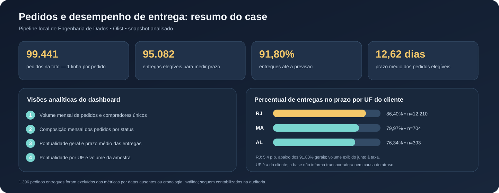
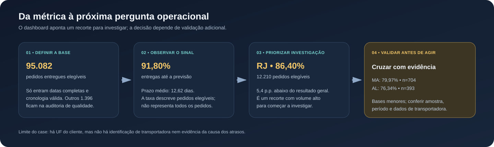
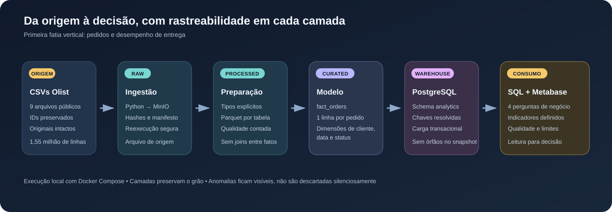

# Olist Data Engineering Case

Este repositório documenta um case local de Engenharia de Dados com os dados públicos de pedidos da Olist. A V1 constrói uma camada analítica e um dashboard para investigar demanda e desempenho de entrega. A primeira entrega da V2 estende o projeto com processamento por lote, manifestos e rastreabilidade até o PostgreSQL.

O projeto demonstra como preservar e validar dados de origem, definir o grão das tabelas, lidar com datas incompletas e inconsistentes e disponibilizar análises com definições, denominadores e limitações explícitos.



> Os números apresentados são referências do snapshot analisado na V1. Setembro e outubro de 2018 têm cobertura parcial. A imagem resume resultados reais do case; não é uma captura de tela do Metabase.

## O problema analítico

Uma operação de e-commerce precisa entender como os pedidos evoluem e se as entregas chegam até a previsão. Um painel sozinho não responde à pergunta de negócio: é preciso definir o grão, o denominador, as regras para datas incompletas e o que uma taxa baixa permite — ou não permite — concluir.

## Escopo analítico do dashboard V1

- **Evolução de pedidos e compradores:** série mensal de pedidos e de compradores identificados por `customer_unique_id`, com sinalização dos meses de cobertura parcial.
- **Composição por status:** participação mensal dos status em gráfico empilhado em 100%; os rótulos da visualização são apresentados em português.
- **Desempenho das entregas:** quantidade de pedidos elegíveis, registros excluídos por datas ausentes ou inconsistentes, prazo médio e percentual entregue até a previsão.
- **Pontualidade por UF:** comparação da taxa de entrega no prazo junto ao tamanho de cada amostra. A visualização descreve diferenças observadas, sem atribuí-las a transportadoras ou causas que não estão identificadas na fonte.

## Leitura analítica do snapshot V1



No snapshot analisado, 91,80% de 95.082 pedidos elegíveis chegaram até a data prevista, com prazo médio de 12,62 dias. Outros 1.396 pedidos entregues foram excluídos dessas métricas porque faltavam timestamps necessários ou a sequência cronológica era inválida; eles continuam visíveis na auditoria de qualidade.

O RJ é um ponto inicial para investigação: teve 12.210 pedidos elegíveis, pontualidade de 86,40% e prazo médio de 15,38 dias — 5,4 pontos percentuais abaixo do resultado geral. MA (79,97%; 704 pedidos) e AL (76,34%; 393 pedidos) também tiveram taxas menores, mas com bases menores. A decisão prudente é validar esses recortes e procurar evidências operacionais antes de priorizar uma intervenção. O dashboard identifica onde olhar; não prova por que o atraso ocorreu.

## Arquitetura analítica V1



| Etapa | Responsabilidade | Evidência / cuidado |
|---|---|---|
| Origem | Nove CSVs públicos da Olist | Os originais não são alterados nem versionados junto ao código. |
| Ingestão e raw | Python copia os arquivos para MinIO e registra hashes e manifestos | A ingestão identifica os arquivos por conteúdo. |
| Processed | Tipagem, validações e Parquet por arquivo | Preserva o grão original; ausências e anomalias são contadas. |
| Curated | Dimensões e fato de pedidos em Parquet | Camada preparada para análise, sem descartar silenciosamente registros problemáticos. |
| Warehouse | PostgreSQL, schema `analytics` | Carga repetível com chaves resolvidas e validação de integridade referencial. |
| Consumo | SQL analítico e Metabase | Indicadores com definições, contexto e limites legíveis para decisão. |

A primeira entrega da V2 acrescenta uma execução identificada por `BATCH_ID`, com arquivos em prefixos próprios no MinIO e carga no schema `analytics_v2`. O procedimento está na seção [V2 — executar um lote](#v2--executar-um-lote).

## Decisões de engenharia demonstradas na V1

- **Grão explícito:** `fact_orders` contém uma linha por pedido (`order_id`). Compradores únicos são contados por `customer_unique_id`, que pode aparecer em mais de um pedido.
- **Fatos não são misturadas:** itens, pagamentos e avaliações podem ter várias linhas por pedido. Juntá-las diretamente pode multiplicar linhas e inflar totais; a V1 mantém o foco em pedidos e entrega.
- **Qualidade rastreável:** inversões entre compra, aprovação, despacho, entrega e previsão são sinalizadas. Métricas de entrega incluem somente pedidos entregues com timestamps necessários presentes e cronologia válida.
- **Atraso não é anomalia temporal:** entrega depois da previsão é um atraso operacional; não é removida como se fosse uma inversão de datas.
- **Integridade e reexecução:** dimensões são carregadas antes da fato, chaves são resolvidas no PostgreSQL e a carga foi reexecutada com o mesmo snapshot sem duplicar pedidos ou produzir órfãos.
- **Apresentação separada dos códigos de origem:** os status originais continuam sendo valores de dados; a visualização converte os rótulos para português para facilitar a leitura.

## Resultados de validação da V1

Resultados observados na cópia analisada, não constantes esperadas para qualquer versão futura do dataset:

| Verificação | Resultado |
|---|---:|
| Pedidos na fato | 99.441 |
| Linhas únicas por pedido | 99.441 |
| Clientes / datas / status na camada dimensional | 99.441 / 800 / 8 |
| Órfãos nas referências de cliente, status e data | 0 |
| Pedidos entregues elegíveis para as métricas de prazo | 95.082 |
| Pedidos entregues excluídos por datas ausentes/inconsistentes | 1.396 |
| Entregas até a previsão / prazo médio | 91,80% / 12,62 dias |

A auditoria também encontrou 166 despachos anteriores à compra, 1.359 anteriores à aprovação e 23 entregas ao cliente anteriores ao despacho. O controle de atraso após a previsão identificou 6.535 timestamps de entrega posteriores ao dia estimado no escopo da auditoria. Esses grupos têm definições e escopos próprios; não devem ser somados como se fossem necessariamente pedidos distintos.

## Explorar por período de compra

Na instância local do Metabase, o dashboard tem o filtro **Período da compra**, uma faixa de datas baseada em `fact_orders.order_purchase_at`. Ele está conectado às cinco visualizações de dados: pedidos e compradores por mês, pedidos por status, total de pedidos, indicadores gerais de entrega e comparação por UF. Assim, volume e métricas de entrega são recalculados para os pedidos comprados no intervalo selecionado; os indicadores de entrega continuam considerando apenas pedidos entregues elegíveis e mantêm os excluídos por timestamps separados.

O filtro foi conferido com 1º de janeiro a 31 de março de 2018: as séries exibiram somente esses três meses, o total foi 21.208 pedidos e os indicadores de entrega retornaram 20.589 elegíveis, 38 excluídos, 15,75 dias de prazo médio e 85,40% no prazo. Ao limpar o filtro, o painel retorna ao snapshot completo.

As caixas de texto **Cobertura dos dados** e **Leituras para decisão** são interpretações fixas do snapshot completo e não acompanham a faixa selecionada. Considere-as como contexto de referência; para uma análise de período específico, use os cartões numéricos e gráficos que respondem ao filtro. A configuração do dashboard permanece na instância local do Metabase e não é exportada junto ao repositório nesta versão.

## Escopo e limitações

- A V1 é local: Docker Compose, MinIO, Python, Parquet, PostgreSQL e Metabase.
- A primeira entrega da V2 implementa o fluxo batch local com identificação do lote, manifestos e carga no schema `analytics_v2`. Ela ainda não inclui Airflow, dbt, streaming, CI/CD, Terraform ou implantação em GCP.
- Setembro e outubro de 2018 são meses parciais; a redução aparente no fim das séries não deve ser lida como queda de demanda ou mudança de operação.
- A taxa de pontualidade descreve pedidos entregues elegíveis, não todos os pedidos.
- A UF é a do cliente. Não há identificador de transportadora nem evidência de causa raiz.
- Na análise do catálogo, algumas categorias não tinham tradução na tabela de referência; os valores de origem foram preservados em vez de traduzidos por suposição.
- O dashboard não substitui investigação operacional nem estima custo de atraso; essas perguntas exigem dados adicionais e uma definição de negócio.
- Na V2, avisos de qualidade são registrados nos manifestos, mas não bloqueiam o lote nesta entrega. Não há quarentena por registro nem limites de bloqueio configurados.

## Documentação

- [Contrato de dados](docs/data_contract.md)
- [Contrato de lote da V1](docs/batch_contract.md)
- [Contrato de lote da V2](docs/batch_contract_v2.md)
- [Modelo dimensional](docs/dimensional_model.md)
- [Ingestão](docs/ingestion.md)
- [Processamento](docs/processed.md)
- [Geração da camada curated](docs/curated.md)
- [Warehouse](docs/warehouse.md)
- [Definições e validação das consultas](docs/analytics_queries.md)
- [Consultas analíticas SQL](sql/analytics/01_orders_delivery.sql)
- [Schema dimensional V2](sql/v2/01_create_analytics_v2.sql)

## V2 — executar um lote

A V2 processa os nove arquivos de origem como um lote identificado por `BATCH_ID`. Execute as etapas na ordem abaixo, dentro da pasta do projeto.

### 1. Preparar o ambiente

Na primeira execução, crie o arquivo local de configuração e ajuste as senhas de desenvolvimento:

```powershell
Copy-Item .env.example .env
```

Não execute novamente esse comando se o `.env` já existir, para evitar substituir sua configuração.

Inicie MinIO e PostgreSQL:

```powershell
docker compose up -d minio postgres
```

No MinIO Console (`http://localhost:9001`), crie o bucket definido por `MINIO_BUCKET` no `.env`. Se não estiver definido, o padrão é `olist-data-lake`. Coloque os nove CSVs em `data/source/`.

O PostgreSQL aplica os scripts em `/docker-entrypoint-initdb.d/` quando inicializa um volume novo. Se o volume já existia antes de o schema V2 ser adicionado ao Compose, os scripts de inicialização não são executados novamente. Nesse caso, aplique o schema V2 uma vez:

```powershell
docker compose exec -T postgres psql -U olist -d olist_analytics -v ON_ERROR_STOP=1 -f /docker-entrypoint-initdb.d/02_create_analytics_v2.sql
```

Os valores `olist` e `olist_analytics` são os padrões de `POSTGRES_USER` e `POSTGRES_DB`. Se o `.env` usar outros valores, ajuste os argumentos do comando.

### 2. Ingerir os arquivos e obter o identificador do lote

```powershell
docker compose --profile jobs run --build --rm ingestion
```

A ingestão calcula e exibe o `BATCH_ID`. Copie o identificador completo, começando com `b_`, e atribua-o a uma variável do PowerShell:

```powershell
$batchId = "b_COLE_AQUI_O_ID_COMPLETO"
```

O identificador representa o conjunto de arquivos de origem e é usado nas etapas seguintes para manter o lote rastreável.

### 3. Processar o lote

```powershell
docker compose --profile jobs run --build --rm -e "BATCH_ID=$batchId" processing
```

### 4. Gerar a camada curated

```powershell
docker compose --profile jobs run --build --rm -e "BATCH_ID=$batchId" curated
```

### 5. Carregar no PostgreSQL

```powershell
docker compose --profile jobs run --build --rm -e "BATCH_ID=$batchId" warehouse_load
```

A carga V2 grava as quatro tabelas analíticas no schema `analytics_v2`: `dim_customer`, `dim_date`, `dim_order_status` e `fact_orders`.

### Onde os resultados são armazenados

- Arquivos de origem: `raw/batches/<BATCH_ID>/`
- Arquivos processados: `processed/batches/<BATCH_ID>/`
- Arquivos analíticos: `curated/batches/<BATCH_ID>/`
- Manifestos de execução: `control/manifests/<etapa>/<BATCH_ID>/<run_id>.json`
- Tabelas no PostgreSQL: schema `analytics_v2`

Os manifestos registram o status, as contagens e as verificações de cada etapa. Os avisos encontrados na qualidade dos dados devem ser avaliados antes do uso em decisões de negócio.

## Evoluções futuras

A V1 concentra-se em pedidos e desempenho de entrega. A primeira entrega da V2 estabelece o processamento batch rastreável até o PostgreSQL. Evoluções futuras podem incluir orquestração com Airflow, transformações com dbt, regras de qualidade com limites e quarentena, governança e proteção de PII, streaming, CI/CD, Terraform e espelhamento de componentes para GCP.

A ampliação do modelo para itens, pagamentos e avaliações também é possível. Cada conjunto deve permanecer em uma fato com grão próprio; comparações entre fatos exigem agregação prévia a um grão comum.